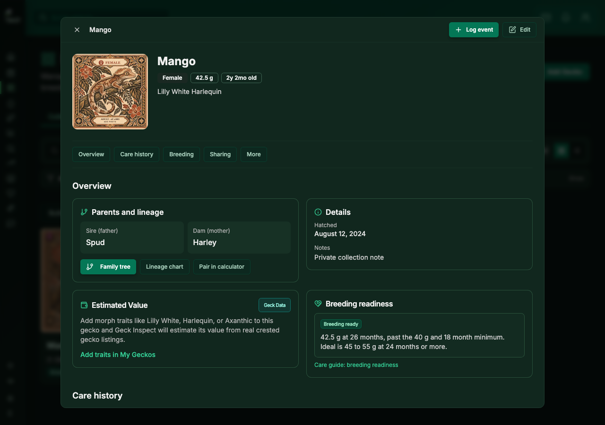
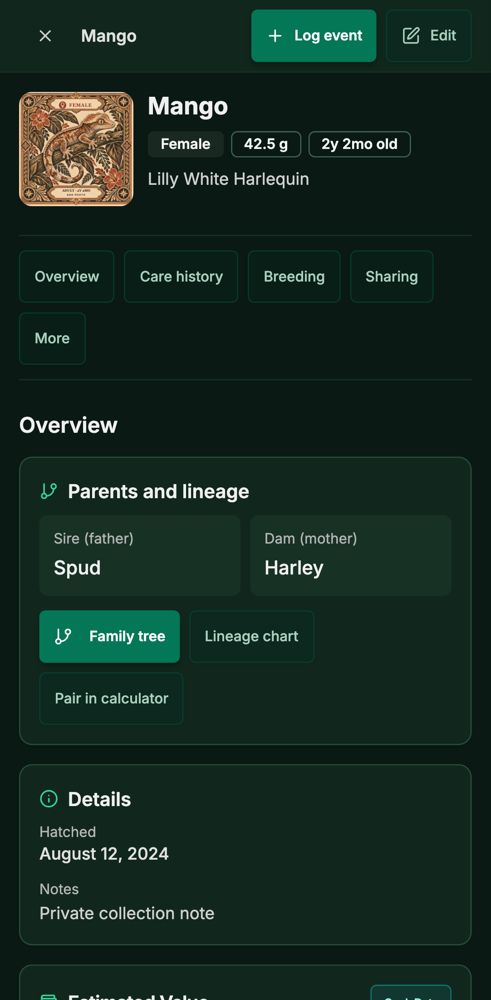

# QR transfer and gecko detail review

Prepared on `codex/qr-transfer-detail` from main `99e61bee`. The existing checkouts and their work were preserved. This branch has not been merged and no production database, account permissions, Auth settings or ownership were changed.

## What changed

Owners can generate a QR link or email-restricted invitation from a gecko record. Links expire after 72 hours and can be reopened or cancelled in Transfers. The database generates the token, checks the current owner and verified recipient, and claims the original record atomically. Repeated or competing claims cannot duplicate ownership history. Private animal details are withheld before authorization.

Signup, confirmation, OAuth, password recovery and login retain the pending claim in the callback URL, with local storage as a fallback. Default implicit confirmation links and token-hash confirmation links were tested in fresh browser contexts. The recipient explicitly accepts ownership and then sees the gecko in their collection. Native owners generate public HTTPS QR links.

The shared gecko record now groups Overview, Care history, Breeding, Sharing and optional tools. Log event and Edit stay visible. Navigation, photo controls and secondary actions use existing design-system buttons. Forms stay mounted so moving between sections does not discard unfinished entries.

## Privacy decision

Plain `geckos.notes` are archived for the seller and shown under their outgoing transfer. The recipient does not receive that private field. Existing animal-specific care, weights and veterinary history follow the app's current owner-access rules, including notes within those records. Shared breeding, eggs, costs and collection records are not copied or given new permissions. Any broader sharing needs a separate decision.

See [the exact database contract, security boundaries and production approval changes](../../planning/qr-transfer-security-2026-10-17.md).

## Screenshots

All screens use synthetic fixtures. QR links point to localhost and do not transfer a real animal.

| Desktop detail | Phone detail |
| --- | --- |
|  |  |

- [Phone Sharing section](phone-detail-sharing.png)
- [Owner QR link](phone-owner-qr-link.png)
- [Private recipient view](phone-private-claim.png)
- [Successful acceptance](phone-claim-success.png)

## Verification

- 26 browser cases passed: 13 at desktop size and 13 with the Pixel 7 phone profile. Four detail checks passed again after tightening screenshot timing.
- Production Vite preview checks passed all 26 desktop and phone cases, including a final run with CI settings after the native loading change and fixture isolation update. Its temporary server and browser workers stopped after each run.
- Browser cases cover signed-in acceptance, signup/verification on a fresh device, lost local continuation, login failure/retry, expired verification, wrong account, closed/invalid links, cancellation, reload after success, collection arrival, section focus, form preservation and mobile overflow.
- Unit suite: 267 files and 3,036 tests passed, including runs with the clock 400 days ahead and 400 days back. GitHub also passed the normal-date suite. Three earlier timeouts reading unchanged files in the Documents checkout disappeared in the temporary checkout.
- ESLint: no errors and 73 existing warnings. Typecheck and the full build passed with fixture configuration. Prerender and SEO audit passed for all 172 routes with no errors, warnings or orphans.
- Database: all 292 migrations replayed, the new migration applied a second time, all 26 regression files passed, all 73 QR assertions passed, and four tests with concurrent database connections passed.
- Database tests run against disposable local fixtures, not customer data. Browser requests to external services were intercepted locally.
- Request-mocked browser contexts block service workers so network routing stays inside the fixtures. Service-worker behavior has separate unit coverage. CI stops at the first exhausted browser failure to upload its trace promptly; no assertions or timeouts were relaxed.
- All 311 size checks pass in the CI-equivalent build. The native sign-in listener loads only on native devices, keeping the public entry at 148.45 kB against 150 kB and the Lilly White guide at 237.59 kB against 238 kB. No allowance was raised. The 23 auth/native callback tests and scoped lint passed after this loading change; native callback and launch-link recovery logic are unchanged.

## Release approval and remaining hosted checks

Automatic Vercel deployment is disabled only for this review branch through `git.deploymentEnabled`. No hosted preview has been published. Local browser screenshots are the verified preview evidence.

Before enabling a hosted preview, verify that it uses a disposable Supabase backend and approve its exact Auth callback allowlist. Before production, approve the migration, its private-note handling and the frontend release together. Existing main consent/privacy and analytics changes remain in this branch.

The hosted Auth email delivery, exact redirect allowlist, and physical native-device callback need a disposable-account check before release. Email templates must retain the nested return URL: the default ConfirmationURL does this; a custom token-hash template must URL-encode RedirectTo when putting it inside next=. Do not add broad wildcards or turn off email verification.
